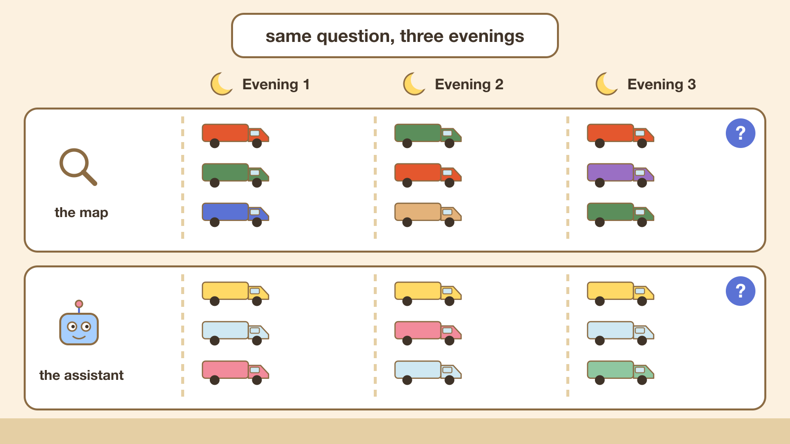

  

## First, an apology

Last week I promised that this part would be about products: what happens when you ask an assistant to find something to *buy* rather than someone to *hire*. I did not finish that work on time, and I would rather say so than publish something half-done. It is now Part 4, and I think it will be worth the wait.

In the meantime, the data I collected for [Part 2](https://feroshjacob.github.io/posts/2026/10/24/ai-search-vs-seo-part-2-google-picked-one-plumber-chatgpt-picked-another) held something I had not looked at closely: how much each answer changed from one evening to the next. This is that post.

## The short version

Everyone "knows" that AI assistants are unpredictable and Google is dependable. Over three evenings of asking the same eight "near me" questions, that is not what I saw.

Google's map box, the three businesses shown above the regular results, changed its line-up from evening to evening. For only one of the seven questions I could compare on all three evenings did it show the same three businesses every night. ChatGPT gave me the same top three on all three evenings for three of the eight questions, and Claude for two.

Neither side was frozen. Any two evenings typically shared about two of their top three, and the rest was swapped, and each kept the same #1 on all three evenings for only about half the questions. The assistants were not the wild ones. They were roughly as steady as Google's map.

The steadiest thing I measured was Google's ordinary list of blue links. That barely moved at all.

## Why does this matter?

Because "AI is random" is often used to wave the whole topic away. In this small test, the assistant's answer was about as repeatable as the map result businesses already pay to appear in.

One honest correction to myself. Last week I wrote that the map moved around more than the chatbot did. When I counted it fairly, comparing the map's three slots with the assistants' top three, the gap mostly disappears. "About as steady" is the accurate version, and it is still the opposite of what most people assume.

## If assistants do not follow Google, what happens to SEO?

This part is opinion, not measurement.

SEO is a large industry, and it is built on things you can see: a position, a report showing where you rank, a click you can count. In Part 2 the assistants did not follow Google's ranking. They rewrote "plumber near me" into "plumber in Marietta" and went reading directory lists, review sites and business websites. A business can do well in one and be absent from the other.

The industry's answer has a name, or rather several: AEO (answer engine optimization), GEO (generative engine optimization), "AI SEO". In my opinion, the fact that it does not yet have one agreed name tells you how young it is. A few other signs:

- **There is no position to report.** If Claude answers with a grouped table, you were not "#3". You were mentioned, or you were not.
- **There is no shared yardstick.** SEO has had years to settle on what to measure. I have not seen an agreed way to measure "how often an assistant recommends me", and anyone measuring it has to deal with the shifting answers above.
- **The advice mostly circles back to the basics.** Be listed on the directories and review sites the assistants read. Use the same business name everywhere. Say plainly on your own website what you do and where. That is good advice. It is also, largely, what good local SEO already told you.

So my view, for now: be cautious of anyone selling a guaranteed "rank #1 in ChatGPT", because there is often no #1 to hold. Be open to the idea that the work which helps you with assistants is mostly ordinary, honest visibility work, done in more places than Google.

I may be wrong, and the field may grow up quickly. That is why I am measuring rather than predicting.

## Next: products

Part 4 is the one I owe you: the same question, but about something you buy instead of someone you hire. A plumber ends in a phone call. A product ends in a cart, and that changes what is at stake.

## How I ran this, and what I am not claiming

Same setup as [Part 2](https://feroshjacob.github.io/posts/2026/10/24/ai-search-vs-seo-part-2-google-picked-one-plumber-chatgpt-picked-another): eight "… near me" questions (plumber, electrician, HVAC repair, roofing contractor, pest control, landscaping, auto repair and dentist), three evenings about 24 hours apart, one laptop in Marietta, Georgia, with Google, Bing, ChatGPT and Claude. "Kept the same" compares each evening's top three with the other evenings'; the map shows only three, so that is the fair comparison. Searches with a mistyped query were left out, which is why one question has only two evenings for the map. New here? Start with [Part 1](https://feroshjacob.github.io/posts/2026/10/18/ai-search-vs-seo-part-1-why-i-am-running-these-experiments) or the [series page](https://feroshjacob.github.io/series/ai-search-vs-seo/).

Eight questions over three evenings in one town can show a direction, not a law. I am not naming any business, and I am still not publishing percentages.
