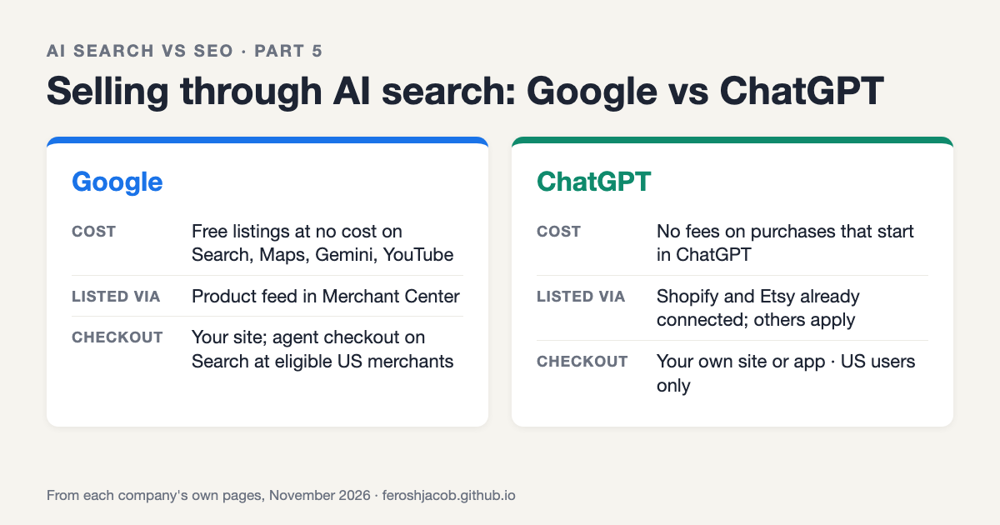
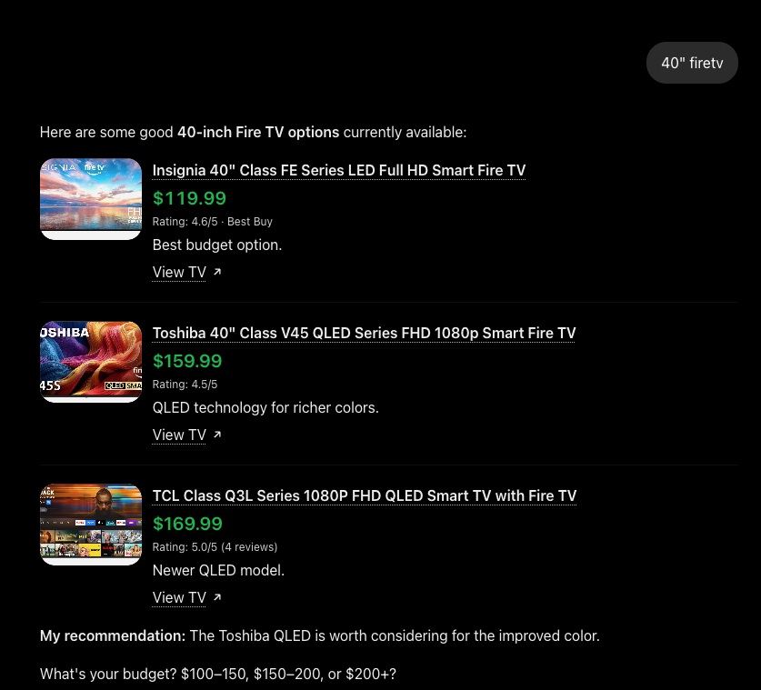

  
   <em>What a seller gets from Google and from ChatGPT today, from each company's own pages, November 2026.</em>

## The short version

Yes, you can be found in ChatGPT today, but the sale happens on your own site. If you sell on Shopify or Etsy, your catalog is already connected. Everyone else applies at [chatgpt.com/merchants](https://chatgpt.com/merchants/). OpenAI says "There are no fees on purchases that start in ChatGPT."

Google already gives sellers more for free than most use, and it is further along on letting an AI agent check out for the shopper.

[Part 4](https://feroshjacob.github.io/posts/2026/11/08/ai-search-vs-seo-part-4-ask-for-a-product-google-shows-stores-claude-reads-reviews) found that an AI assistant asked for a product reads reviews, not stores. This part looks at the seller's side.

## What does Google already give sellers for free?

**Free listings.** Upload your products to Google Merchant Center and, in Google's words, ["the products you sell can appear at no cost on Google Search, Google Maps, Gemini, YouTube"](https://support.google.com/merchants/answer/9199328), plus Images, Lens and the Shopping tab. Google says they appear "alongside any existing paid ad campaigns".

Google is also building for agents:

- **Agent Payments Protocol (AP2)**, September 2025: [an open protocol](https://cloud.google.com/blog/products/ai-machine-learning/announcing-agents-to-payments-ap2-protocol/) for payments an AI agent makes, backed by more than 60 organizations.
- **Agentic checkout on Search and AI Mode**, from November 2025: when a tracked price falls into the range the shopper set, Google sends a notification with a "Buy for me" button, and an [AI agent completes the purchase](https://9to5google.com/2025/11/13/google-agentic-shopping/) on the merchant's site. It works at eligible US merchants, including Wayfair, Chewy, Quince and select Shopify merchants. Google can also call nearby stores to check what they have in stock.
- **Universal Commerce Protocol (UCP)**, January 2026: [an open standard](https://blog.google/products/ads-commerce/agentic-commerce-ai-tools-protocol-retailers-platforms/) co-developed with Shopify, Etsy, Wayfair, Target and Walmart. The same announcement added **Business Agent**, which lets shoppers chat with a brand on Search.

## How does ChatGPT compare, and what is on its roadmap?

ChatGPT started where Google is heading. On 29 September 2025 OpenAI launched [Instant Checkout](https://stripe.com/newsroom/news/stripe-openai-instant-checkout) with Etsy, built on the Agentic Commerce Protocol, an open standard co-developed by Stripe and OpenAI.

OpenAI's [merchants page](https://chatgpt.com/merchants/) now says it is "moving away from a standalone Instant Checkout experience", and purchases are completed on the merchant's own site or app. [ForkLog](https://forklog.com/en/openai-abandons-instant-checkout-feature-in-chatgpt/), citing The Information, reported in March 2026 that Instant Checkout was being discontinued.

This is what a shopper sees today. Asked for a 40-inch Fire TV, ChatGPT lists products with a photo, price, rating and a "View TV" link out:

  
   <em>ChatGPT's product results for the prompt <code>40" firetv</code>, November 2026. Screenshot by the author.</em>

What the merchants page offers today:

- Shopify and Etsy catalogs are already integrated, with no application.
- Other merchants apply to share their product data.
- Shopping is live for US users only.
- No fees on purchases that start in ChatGPT.

On the roadmap, OpenAI has announced or is testing two things. It [began testing ads](https://www.techcrunch.com/2026/02/09/chatgpt-rolls-out-ads/) in the US for Free and Go users in February 2026. Its merchants page, which carries no date, says it aims to have "a self-serve merchant portal later this year". I found no other published roadmap.

| For a seller | Google | ChatGPT |
|---|---|---|
| Cost | Free listings at no cost; paid ads are separate | No fees on purchases that start in ChatGPT |
| How to get listed | Product feed in Merchant Center | Shopify and Etsy: already connected; others apply |
| Where checkout happens | Your site; agentic checkout on Search at eligible US merchants | Your own site or app |
| Status | Free listings live; agentic checkout rolling out in the US | Live for US users; moving away from standalone Instant Checkout |

## How are retailers looking at this, and how many sell on ChatGPT?

In a [BCG study](https://www.bcg.com/publications/2026/retailers-win-ai-shopping-agents) published in October 2026, "68% of retailers expect agentic commerce to have a significant or transformational effect within two years". Losing the customer relationship was the most common concern, cited by 91%. My reading, not a finding: sending the purchase back to the merchant's site eases part of that worry, because the merchant keeps the order and the customer.

Shoppers are moving too. [Adobe](https://news.adobe.com/news/2026/01/adobe-holiday-shopping-season) measured traffic to US retail sites from generative AI tools up 693.4% in the 2025 holiday season, year over year, though it notes the base of users remains modest.

**How many retailers are on ChatGPT?** OpenAI publishes no count. The closest figure is Shopify's: ["Millions of stores are selling in Microsoft Copilot and ChatGPT"](https://www.shopify.com/blog/agentic-commerce). Read that as stores whose catalogs are connected and eligible to appear, not a count of stores making sales there.

## What can a small seller do this week?

- **Turn on free listings** in Google Merchant Center; it costs nothing.
- **Clean your product feed**: titles, prices, stock and images that match your site, because Google and ChatGPT both read product data.
- **On Shopify or Etsy?** Your catalog is already connected to ChatGPT; check that the product data is accurate.
- **Anywhere else?** Apply at [chatgpt.com/merchants](https://chatgpt.com/merchants/) to share your product data.

## What's next

Part 4 left ChatGPT out of the product test. A later part will run the same product searches in ChatGPT and see which stores it sends shoppers to.
